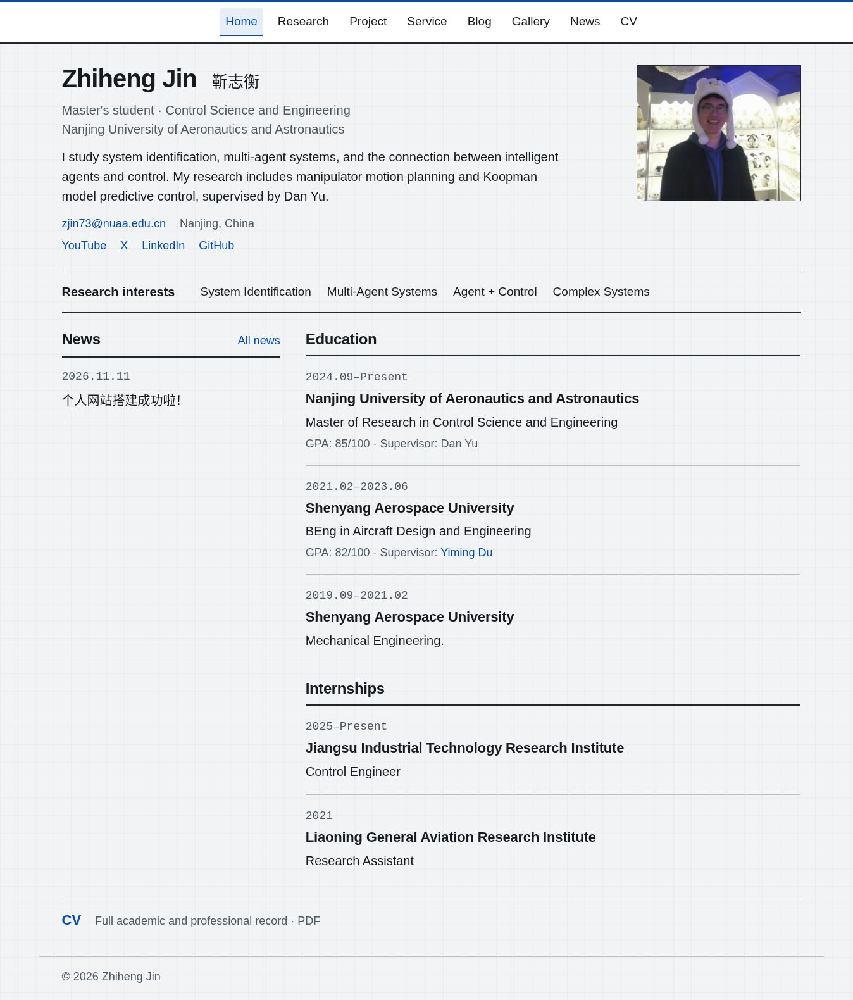
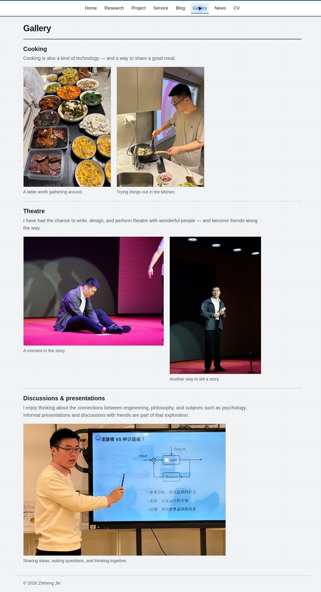
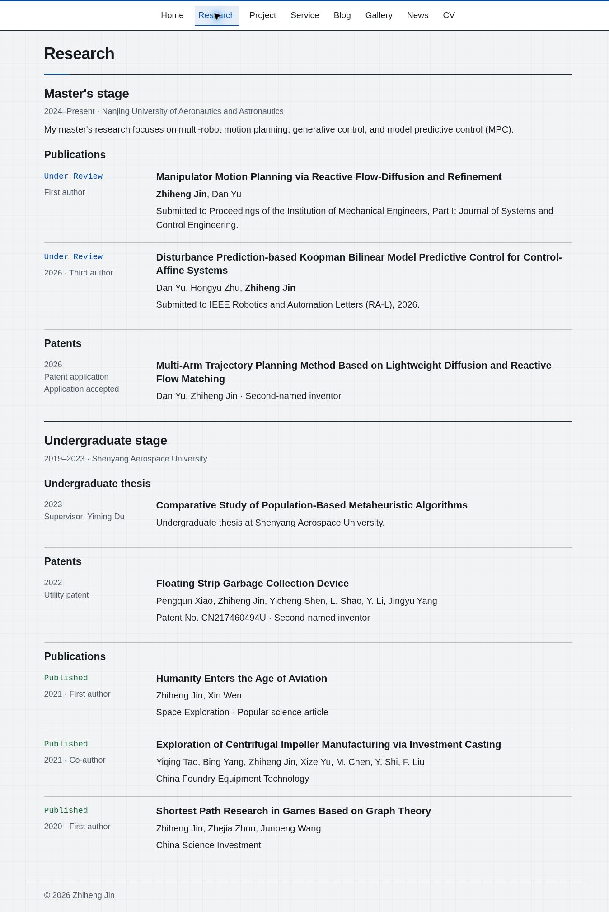
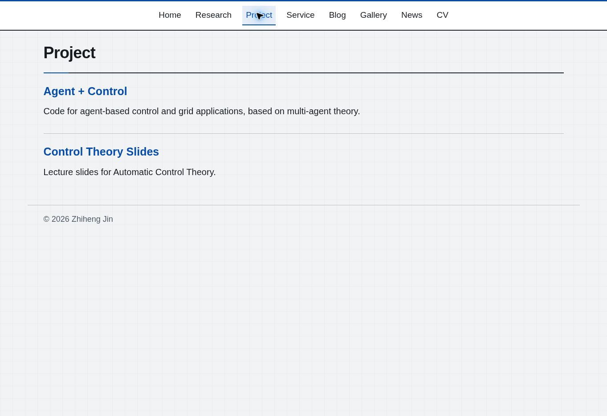
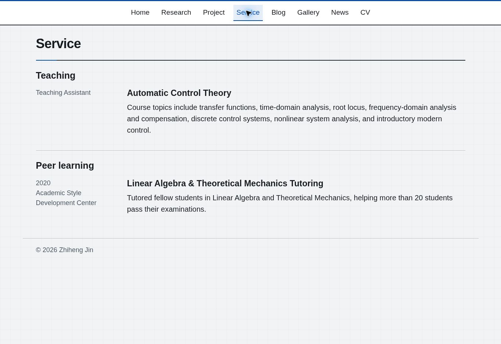
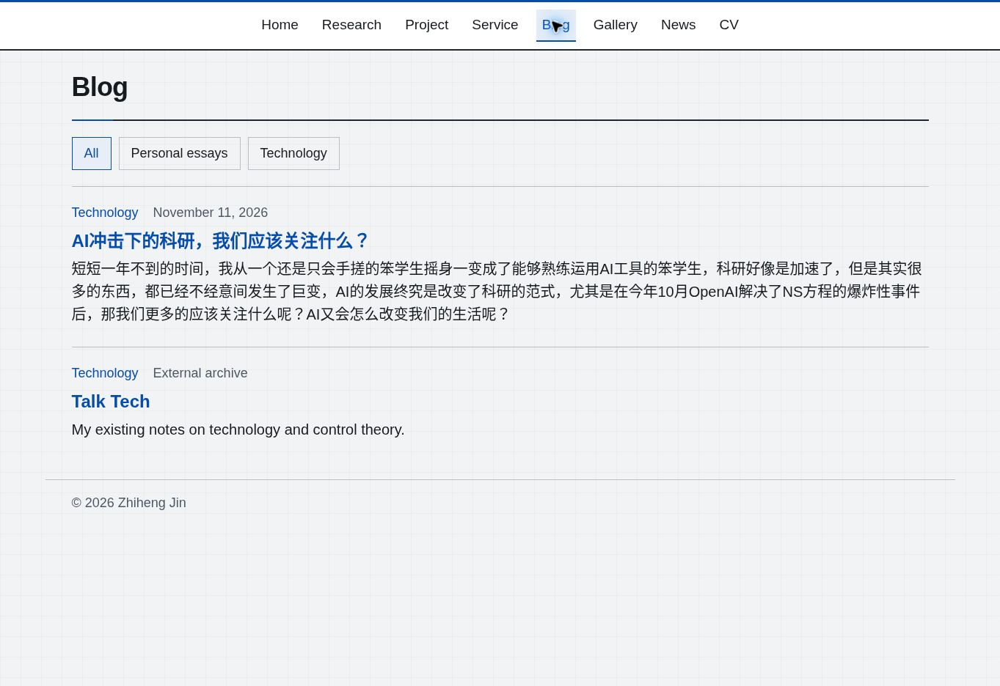
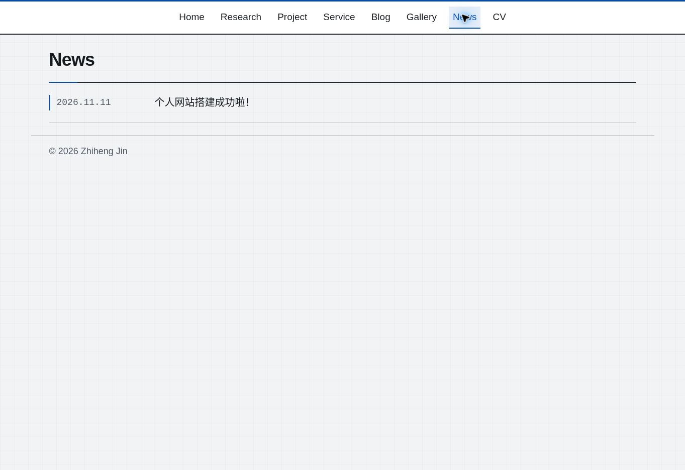
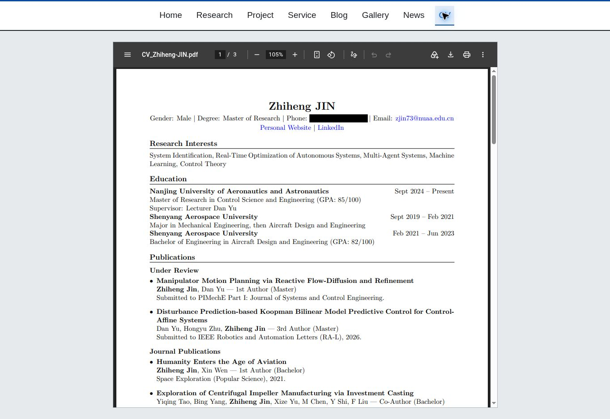

# 当前网站样貌

核对日期：2026-11-12（北京时间）。这些截图记录当时实际线上页面，不是设计示意图。主导航、字体和布局与源码对应；内容继续更新后，截图需要另行更新。

维护说明：[instruction.md](../instruction.md)。截图存放于 `docs/screenshots/`；`docs/` 已从 Jekyll 网站构建中排除，只用于仓库维护文档。网站使用的原照片仍在 `assets/images/`，不能用本目录截图代替。

| 页面 | 当前结构 | 截图 |
| --- | --- | --- |
| Home | 姓名介绍与固定照片；研究兴趣；左 News、右教育和实习 | [完整首页](screenshots/home.png) |
| Research | 硕士在前、本科在后；各阶段论文和专利 | [研究页](screenshots/research.png) |
| Project | Agent + Control；Control Theory Slides | [项目页](screenshots/project.png) |
| Service | Teaching 与 Peer learning | [服务页](screenshots/service.png) |
| Blog | 两类文章筛选、文章列表、Talk Tech 入口 | [博客页](screenshots/blog.png) |
| Gallery | Cooking、Theatre、Discussions & presentations，五张照片 | [完整相册](screenshots/gallery.png) |
| News | 新到旧的时间线 | [动态页](screenshots/news.png) |
| CV | 居中真实 PDF 阅读器，手机号已涂黑 | [CV 首屏](screenshots/cv.png) |

## Home

## Gallery

## 其余页面

桌面截图宽度约 1360px。CV 截图是阅读器首屏；PDF 内部可滚动翻页，工具栏和缩放因浏览器不同而异。窄屏布局由 `assets/css/researcher.css` 的媒体查询控制：导航换行、内容纵向排列、相册单列，照片保持原比例。
